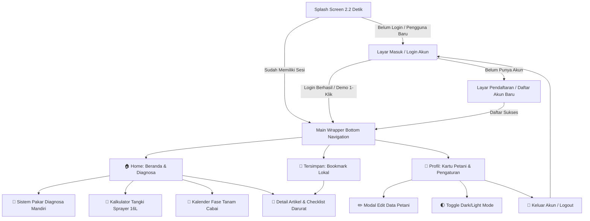
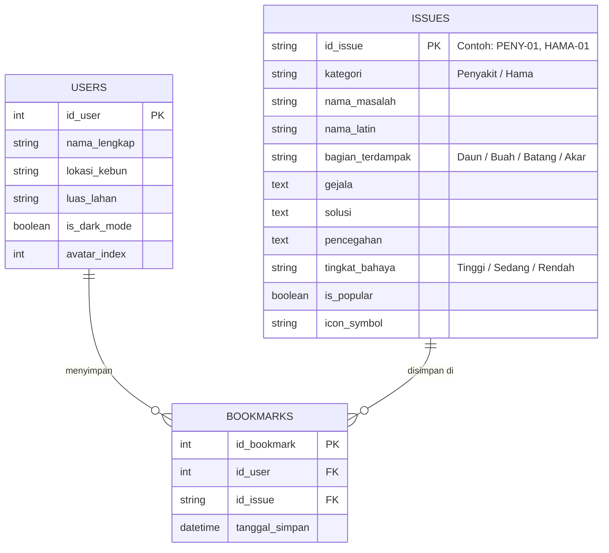

# 🌶️ ChiliPedia (Ensiklopedia Hama & Penyakit Cabai) — Versi Lengkap & Canggih

**ChiliPedia** adalah platform agrikultur modern berbasis Flutter (Android) yang dirancang sebagai asisten ensiklopedia komprehensif dan **Sistem Pakar Diagnosa Mandiri** bagi petani cabai Indonesia. Aplikasi berjalan **100% offline** tanpa ketergantungan API eksternal, dilengkapi algoritma inferensi gejala, kalkulator tangki semprotan, kalender fase tanam, profil petani interaktif, serta sistem bookmark lokal.

---

## 🌟 Fitur Canggih & Komponen Unggulan (Nilai Tambah Dosen)

### 1. 🔬 Sistem Pakar Diagnosa Gejala Cerdas (Smart Diagnostic Wizard)
- **Algoritma Forward Chaining & Multi-Factor Scoring**:
  - Langkah 1: Pemilihan organ/bagian tanaman yang sakit (*Daun, Buah, Batang, Akar*).
  - Langkah 2: Seleksi ciri-ciri fisik spesifik (*Klorosis kuning, daun mangkuk/perak, bercak melekuk patek, busuk basah, dll.*).
  - Langkah 3: Korelasi faktor lingkungan (*Musim Hujan/Lembap vs Kemarau/Panas Terik*).
- Menghasilkan **Persentase Akurasi Kecocokan (Confidence Score)**, tingkat probabilitas, dan tombol langsung ke penanganan darurat.

### 2. 🧪 Kalkulator Dosis Tangki Sprayer Petani (Agri-Calculator)
- Menghitung takaran pestisida / fungisida per tangki standar semprotan (14L, 16L, 20L).
- Menghitung kebutuhan total volume air, estimasi jumlah tangki untuk luas lahan tertentu, serta total gram/ml obat yang harus disiapkan.
- Dilengkapi SOP waktu aplikasi terbaik (*Pagi jam 06.00-09.00 saat stomata terbuka atau Sore jam 15.30-17.30*).

### 3. 📋 Checklist Tanggap Darurat 24 Jam di Layar Detail
- Tab navigasi terstruktur pada setiap penyakit:
  - 🔬 **Gejala & Karakteristik Fisik**
  - 💊 **Solusi Teknis, Hayati, & Kimiawi**
  - 📋 **Checklist Tanggap Darurat 1x24 Jam**: Petani dapat mencentang langsung tindakan lapangan (Eradikasi, Semprot Bawah Daun, Perbaikan Drainase, Tambahan Kalsium).
- Dilengkapi tombol **Salin Ringkasan (Share to Clipboard)** untuk memudahkan petani berkonsultasi via WhatsApp.

### 4. 📅 Panduan Kalender & Fase Rawat Tanam Cabai
- Modal interaktif panduan perawatan berdasarkan umur tanaman:
  - Fase 1: Semai & Vegetatif (0 - 30 HST)
  - Fase 2: Generatif & Pembungaan (30 - 65 HST)
  - Fase 3: Pematangan Buah & Panen (> 65 HST)

### 5. 🪪 Kartu Anggota Petani Digital (Digital Farmer ID)
- Tampilan kartu identitas petani modern bergaya *e-money / credit card* dengan status *Terverifikasi*, ID registrasi unik, avatar kustom, dan statistik kepemilikan lahan.

### 6. 🌓 Dual Mode: Agritech Light & OLED Dark Theme
- Mode Terang bersih dengan aksen *Forest Green* (`#1B5E20`) dan *Chili Red* (`#D32F2F`).
- Mode Gelap hemat baterai (OLED deep charcoal) yang nyaman untuk inspeksi hama malam hari.

---

## 📱 Arsitektur Layar & Alur Otentikasi (Auth Flow)



---

## 🗄️ Entity Relationship Diagram (ERD) - Database Lokal



---

## 📁 Struktur Direktori Proyek

```
lib/
├── data/
│   ├── database_service.dart          # Layanan database lokal offline (CRUD User, Bookmark, Search Issues)
│   ├── diagnostic_data.dart           # Engine inferensi sistem pakar & bank data gejala
│   └── initial_issues_data.dart       # Katalog 12 hama & penyakit cabai Indonesia
├── models/
│   ├── bookmark_model.dart            # Model data relasi bookmark
│   ├── diagnostic_model.dart          # Model opsi gejala & hasil skor probabilitas
│   ├── issue_model.dart               # Model data ensiklopedia hama & penyakit
│   └── user_model.dart                # Model data profil petani
├── screens/
│   ├── bookmark_screen.dart           # Layar daftar tersimpan & unbookmark
│   ├── calculator_screen.dart         # Layar kalkulator takaran tangki semprot
│   ├── detail_screen.dart             # Layar artikel, tab solusi, & checklist darurat
│   ├── diagnostic_wizard_screen.dart  # Layar sistem pakar diagnosa gejala bertahap
│   ├── home_screen.dart               # Beranda utama, cuaca, aksi cepat, & katalog
│   ├── login_screen.dart              # Layar masuk akun petani & tombol demo 1-klik
│   ├── main_wrapper.dart              # Pembungkus Bottom Navigation Bar (IndexedStack)
│   ├── profile_screen.dart            # Layar profil petani, kartu anggota digital, logout
│   ├── register_screen.dart           # Layar pendaftaran akun baru petani & avatar picker
│   ├── splash_screen.dart             # Layar pembuka logo 2.2 detik & cek sesi
│   └── widgets/
│       ├── diagnosis_filter.dart      # Widget filter bagian tanaman & kategori
│       ├── empty_state.dart           # Widget state kosong (search/bookmark)
│       ├── issue_card.dart            # Kartu item katalog dengan badge dan bookmark
│       ├── popular_carousel.dart      # Slider horizontal penyakit populer mewabah
│       └── weather_card.dart          # Kartu greeting dinamis & cuaca pertanian
├── state/
│   └── app_state.dart                 # State management reaktif (ChangeNotifier)
├── theme/
│   └── app_theme.dart                 # Material 3 Light & Dark mode (Forest Green & Chili Red)
└── main.dart                          # Entry point aplikasi
```

---

## 🎯 Poin Penilaian Maksimal (Presentasi di Depan Dosen)

| Komponen Pengujian | Implementasi di ChiliPedia |
| :--- | :--- |
| **Algoritma Cerdas** | Sistem pakar inferensi gejala bertahap (*Forward Chaining*) dengan pembobotan cuaca dan kalkulasi persentase akurasi kecocokan (*Confidence Level*). |
| **Utilitas Nyata** | Kalkulator semprotan tangki (*sprayer 16L*) untuk menghitung takaran ml/L secara presisi di lapangan. |
| **State Management** | `IndexedStack` mempertahankan form input & posisi scroll saat berpindah tab. Didukung `ChangeNotifier` untuk reaktivitas global. |
| **Local Storage / CRUD** | **Create** (Daftar & Bookmark), **Read** (Katalog & Query Search), **Update** (Edit Profil & Dark Mode), **Delete** (Hapus Bookmark & Reset). |
| **UI/UX Standar Industri** | Desain startup agritech modern, Hero transition antar layar, haptic feedback, Kartu Anggota Digital, dan mode gelap murni. |

---

## 🚀 Cara Menjalankan

```bash
# Analisis kode
flutter analyze

# Jalankan aplikasi
flutter run
```
